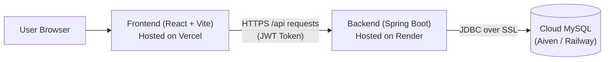

# WorkFlowOS — GitHub Push & Separate Deployment Guide (`help.md`)

This guide walks you step-by-step through:
1. **Pushing your Frontend and Backend to GitHub** (either as 2 separate repositories or a clean mono-repository).
2. **Deploying the MySQL Database** in the cloud.
3. **Deploying the Spring Boot Backend** (on Render or Railway).
4. **Deploying the React + Vite Frontend** (on Vercel or Netlify).
5. **Connecting them together** seamlessly.

---

## 📋 Table of Contents
- [Architecture Overview](#architecture-overview)
- [Pre-Flight: Files Prepared for You](#pre-flight-files-prepared-for-you)
- [Step 1: Push Frontend & Backend to GitHub](#step-1-push-frontend--backend-to-github)
  - [Option A: Two Separate GitHub Repositories (Recommended)](#option-a-two-separate-github-repositories-recommended)
  - [Option B: Single Repository (Monorepo)](#option-b-single-repository-monorepo)
- [Step 2: Deploy Cloud MySQL Database](#step-2-deploy-cloud-mysql-database)
- [Step 3: Deploy Backend (Spring Boot on Render)](#step-3-deploy-backend-spring-boot-on-render)
- [Step 4: Deploy Frontend (React + Vite on Vercel)](#step-4-deploy-frontend-react--vite-on-vercel)
- [Step 5: Testing & Verification Checklist](#step-5-testing--verification-checklist)
- [Common Troubleshooting](#common-troubleshooting)

---

## 🏗️ Architecture Overview



| Component | Technology | Recommended Host | Free Tier Available? |
| :--- | :--- | :--- | :--- |
| **Frontend** | React 18 + Vite | [Vercel](https://vercel.com) / [Netlify](https://netlify.com) | ✅ Yes (Free) |
| **Backend** | Spring Boot 3.3.5 (Java 17) | [Render](https://render.com) / [Railway](https://railway.app) | ✅ Yes (Free) |
| **Database** | MySQL 8.x | [Aiven](https://aiven.io) / [Railway](https://railway.app) / [Clever Cloud](https://clever-cloud.com) | ✅ Yes (Free) |

---

## 🛠️ Pre-Flight: Files Prepared for You

To make your deployment effortless, the following configuration files have already been created in your project:

1. **`backend/src/main/resources/application.properties`**: Updated with dynamic environment variable placeholders (`${SPRING_DATASOURCE_URL:...}`, `${PORT:...}`, `${JWT_SECRET:...}`) with local fallbacks so your local setup continues to work unchanged.
2. **`.gitignore` (in root, `backend/`, and `frontend/`)**: Automatically prevents committing massive folders (`node_modules/`, `target/`), local files (`.vscode/`), and local secrets (`.env.local`).
3. **`frontend/vercel.json` & `frontend/public/_redirects`**: Configured for Single Page Application (SPA) URL rewrites so refreshing `/login` or `/admin/users` on Vercel/Netlify does not return a 404.
4. **`backend/Dockerfile`**: Multi-stage production container allowing one-click build and deployment on any cloud provider that supports Docker (Render, Railway, Fly.io).

---

## Step 1: Push Frontend & Backend to GitHub

### Option A: Two Separate GitHub Repositories (Recommended)
Having two repositories (`workflowos-backend` and `workflowos-frontend`) is the industry standard for independent deployments because each project has its own root directory and separate Git commit history.

#### 1. Push Backend to GitHub:
1. Open [GitHub](https://github.com/new) and click **New Repository**.
   - Name: `workflowos-backend`
   - Visibility: Public or Private
   - Do **NOT** initialize with README, .gitignore, or license (leave empty).
2. Open PowerShell in your project terminal and run:
   ```powershell
   cd c:\Users\Shivani\.vscode\WorkFlowOS\backend
   git init
   git add .
   git commit -m "feat: initial commit of WorkFlowOS Spring Boot backend"
   git branch -M main
   git remote add origin https://github.com/YOUR_GITHUB_USERNAME/workflowos-backend.git
   git push -u origin main
   ```
   *(Replace `YOUR_GITHUB_USERNAME` with your real GitHub handle).*

#### 2. Push Frontend to GitHub:
1. Go to [GitHub](https://github.com/new) and create a second repository:
   - Name: `workflowos-frontend`
   - Visibility: Public or Private
   - Leave empty without README or .gitignore.
2. In PowerShell, navigate to the frontend folder and run:
   ```powershell
   cd c:\Users\Shivani\.vscode\WorkFlowOS\frontend
   git init
   git add .
   git commit -m "feat: initial commit of WorkFlowOS React Vite frontend"
   git branch -M main
   git remote add origin https://github.com/YOUR_GITHUB_USERNAME/workflowos-frontend.git
   git push -u origin main
   ```

---

### Option B: Single Repository (Monorepo)
If you prefer keeping everything in one repository (`WorkFlowOS`) on GitHub:

1. Create a repository on GitHub named `workflowos`.
2. In PowerShell at the root of the project:
   ```powershell
   cd c:\Users\Shivani\.vscode\WorkFlowOS
   git init
   git add .
   git commit -m "feat: initial commit of WorkFlowOS full-stack system"
   git branch -M main
   git remote add origin https://github.com/YOUR_GITHUB_USERNAME/workflowos.git
   git push -u origin main
   ```
> [!NOTE]
> If you choose Option B, when connecting to Vercel or Render later, simply configure **Root Directory** as `frontend` for the frontend service, and `backend` for the backend service.

---

## Step 2: Deploy Cloud MySQL Database

Your backend requires a running MySQL database. You can use any free cloud MySQL provider:

### Recommended Option: Aiven Cloud MySQL (Free Plan / Trial)
1. Sign up at [Aiven.io](https://aiven.io).
2. Click **Create Service** → Select **MySQL**.
3. Choose the free plan and your nearest region (e.g. Frankfurt, Singapore, North Virginia).
4. Once active, note the connection details:
   - **Host** (e.g., `mysql-xxxx.aivencloud.com`)
   - **Port** (e.g., `12345`)
   - **User** (e.g., `avnadmin`)
   - **Password** (e.g., `AVNS_...`)
   - **Database Name** (e.g., `defaultdb` or create `workflowos`)

### Alternative: Railway MySQL
1. Sign up at [Railway.app](https://railway.app).
2. Click **New Project** → **Provision MySQL**.
3. Under the **Connect** tab, copy the `MYSQL_URL` or individual host, port, username, password.

### Run Schema & Initial Seed Data
Open your preferred database client (MySQL Workbench, DBeaver, or command line) and connect to your cloud database, then execute:
1. `database/schema.sql` (Creates all tables and indexes).
2. `database/sample-data.sql` (Seeds default departments, users, and workflow rules).

*(Or if you prefer, you can copy the contents of `database/schema.sql` and run them directly in the Aiven or Railway SQL console).*

---

## Step 3: Deploy Backend (Spring Boot on Render)

We recommend [Render](https://render.com) for hosting Java Spring Boot applications.

### 1. Create Web Service on Render
1. Sign up / Log in to [Render Dashboard](https://dashboard.render.com).
2. Click **New +** → **Web Service**.
3. Connect your GitHub account and select your backend repository (`workflowos-backend` or `workflowos`).

### 2. Configure Service Settings
- **Name**: `workflowos-backend`
- **Region**: Choose the region closest to your cloud database
- **Branch**: `main`
- **Root Directory**:
  - If Option A (separate repo): Leave empty.
  - If Option B (monorepo): Set to `backend`.
- **Runtime**:
  - **Docker** (Recommended! Render will automatically detect `backend/Dockerfile` and build it with Java 17).
  - *OR Native Java*:
    - Build Command: `mvn clean package -DskipTests`
    - Start Command: `java -jar target/backend-0.0.1-SNAPSHOT.jar`
- **Instance Type**: Free

### 3. Add Environment Variables
Scroll to **Environment Variables** and add the exact variables below (**No changes required!**):

| Key | Exact Value | Notes |
| :--- | :--- | :--- |
| `PORT` | `8080` | Render port |
| `JWT_SECRET` | `404E635266556A586E3272357538782F413F4428472B4B6250645367566B5970` | 256-bit secure key |
| `SPRING_DATASOURCE_URL` | `jdbc:h2:file:./workflowos_db;DB_CLOSE_DELAY=-1;MODE=MySQL;DATABASE_TO_LOWER=TRUE` | Embedded DB (zero setup needed) |
| `SPRING_DATASOURCE_USERNAME` | `sa` | Default username |
| `SPRING_DATASOURCE_PASSWORD` | *(leave empty)* | No password needed |
| `SPRING_JPA_HIBERNATE_DDL_AUTO` | `update` | Auto-creates tables & seeds data |

*(Note: If you later decide to use an external Cloud MySQL database like Aiven or Railway, you can simply change `SPRING_DATASOURCE_URL`, `SPRING_DATASOURCE_USERNAME`, and `SPRING_DATASOURCE_PASSWORD`).*

### 4. Deploy & Get Backend URL
1. Click **Deploy Web Service**.
2. Wait 2–3 minutes for the build and container startup to complete.
3. Look at the logs. When you see `Started BackendApplication in X.XXX seconds`, your backend is live!
4. Copy your live backend URL from Render:
   `https://workflowos-7lfd.onrender.com`

> [!NOTE]
> ### 💡 Why visiting `https://workflowos-7lfd.onrender.com` in a browser says "Access Denied"
> **Your backend is 100% healthy, running, and working properly!**
> 
> Because WorkFlowOS backend is a **pure REST API** secured by Spring Security with JWT tokens:
> 1. It is not an HTML website — it does not serve web pages at the root `/`.
> 2. When you visit `https://workflowos-7lfd.onrender.com` directly in a browser, your browser sends a request with no JWT authorization header.
> 3. Spring Security intercepts the unauthenticated request and correctly responds with **HTTP 403 Forbidden ("Access Denied")**. This is expected and standard security behavior for enterprise REST APIs.
>
> **Verification (Proof that it is live & healthy):**
> Run this command in your PowerShell terminal to test the login endpoint:
> ```powershell
> curl.exe -X POST https://workflowos-7lfd.onrender.com/api/auth/login -H "Content-Type: application/json" -d '{\"email\":\"admin@workflowos.com\",\"password\":\"password123\"}'
> ```
> It returns `HTTP 200 OK` with your admin user profile and a signed JWT authentication token!

---

## Step 4: Deploy Frontend (React + Vite on Vercel)

[Vercel](https://vercel.com) provides instant, global CDN hosting for Vite and React apps.

### 1. Import Repository on Vercel
1. Log in to [Vercel](https://vercel.com).
2. Click **Add New...** → **Project**.
3. Import your frontend repository (`workflowos-frontend` or `workflowos`).

### 2. Configure Build Settings
- **Framework Preset**: `Vite` (automatically detected)
- **Root Directory**:
  - If Option A (separate repo): Leave `./`
  - If Option B (monorepo): Click **Edit** and select `frontend`
- **Build Command**: `npm run build`
- **Output Directory**: `dist`

### 3. Add Environment Variables
Expand the **Environment Variables** section:

| Key | Exact Value | Notes |
| :--- | :--- | :--- |
| `VITE_API_BASE_URL` | `https://workflowos-7lfd.onrender.com/api` | Your live Render backend API URL (includes `/api`) |

### 4. Click Deploy
1. Click **Deploy**.
2. Vercel will build and deploy your React application in ~30 seconds.
3. You will receive your production URL:
   `https://workflowos-frontend.vercel.app`

---

## Step 5: Testing & Verification Checklist

Once both services are deployed, test your end-to-end workflow:

1. **Access the Application**: Open your live Vercel URL (`https://workflowos-frontend.vercel.app`).
2. **Login**:
   - **Email**: `admin@workflowos.com`
   - **Password**: `password123`
3. **Verify Functionality**:
   - Dashboard statistics and metrics load properly.
   - Navigate to **Requests** and submit a new test request (e.g. Software Purchase, $1,200).
   - Log in as the manager (`manager.eng@workflowos.com` / `password123`) to view and approve/reject the request.
   - Verify Audit Trail logs record the approval timeline.
4. **Test Browser Refresh**:
   - Refresh the page while on `https://workflowos-frontend.vercel.app/admin/users`.
   - The page should reload cleanly without a 404 (handled by `vercel.json`).

---

## 🔍 Common Troubleshooting

### 1. Frontend gets `Network Error` or `Failed to fetch`
- **Cause**: Backend is asleep (free Render instances sleep after 15 minutes of inactivity) or `VITE_API_BASE_URL` is misconfigured.
- **Fix**: Open the backend URL `https://your-backend.onrender.com/api/departments` directly in a browser tab. If it is waking up from sleep, wait 30 seconds. Also check that `VITE_API_BASE_URL` in Vercel settings has `/api` at the end.

### 2. 404 Not Found when reloading pages on Vercel
- **Cause**: Static server trying to find `/admin/users/index.html` instead of falling back to `/index.html`.
- **Fix**: We have already created `frontend/vercel.json` with rewrite rules. Ensure `vercel.json` is committed and pushed.

### 3. Database connection failure on backend startup (`Communications link failure`)
- **Cause**: Cloud MySQL host, port, or SSL parameters are incorrect.
- **Fix**: Ensure your `SPRING_DATASOURCE_URL` includes `?useSSL=true&allowPublicKeyRetrieval=true&serverTimezone=UTC` and that the cloud database allows incoming connections from any IP (`0.0.0.0/0`).

### 4. CORS Errors in browser console
- **Status**: Backend has already been configured in `SecurityConfig.java` with `configuration.setAllowedOriginPatterns(List.of("*"))` and `allowCredentials(true)`. Requests from your Vercel domain will be accepted automatically.

---

### Need Quick Local Testing?
You can still run locally anytime:
- **Backend**: In `backend/`, run `./mvnw spring-boot:run` or launch `BackendApplication.java` in VS Code.
- **Frontend**: In `frontend/`, run `npm run dev`.
